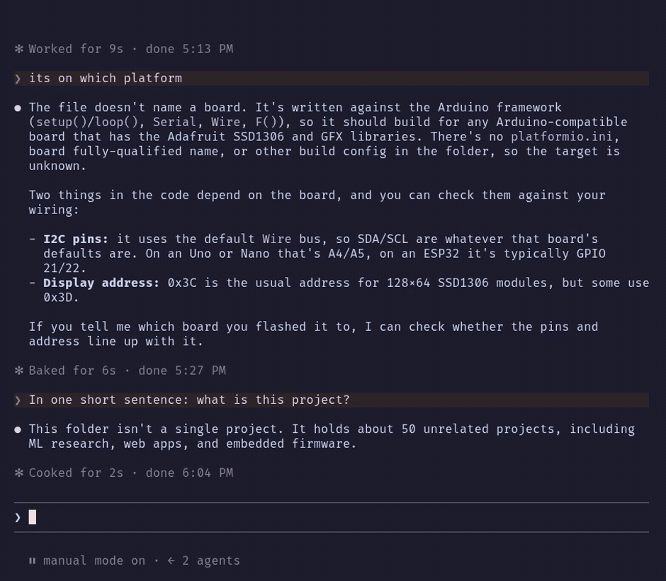

<div align="center">


</div>

**Keep Claude Code's prompt cache warm while you're away.**



[](https://github.com/404Mayank/cachebeat/actions/workflows/ci.yml)
[](https://code.claude.com/docs/en/plugins/mods/overview)
[](LICENSE)

When a Claude Code session sits idle, its prompt cache expires, and your next message has to rebuild it from scratch. That's slower, and it uses more of your usage limits. cachebeat gives the session a heartbeat: shortly before the cache would expire, it sends a tiny background request that reads the conversation and keeps the cache alive. Your transcript never sees it.

You come back from lunch, type your next message, and it picks up right where you left off.

## Features

- **Background beats** keep the cache warm while you're idle or a turn sits waiting, timed to how long your cache lasts, and stay out of the conversation
- **A live heart** under the prompt, with 19 animations to choose from
- **A turn line** under your latest turn shows the beats so far and the time until the next one
- **A settings menu** with live previews, driven by keyboard or mouse
- **Ask Claude** to turn it on, change the interval, or change any setting, in your own words
- **Safety stops** for long idle stretches, usage limits, errors, and chats too small to bother with
- **This session, this folder or all folders**: turn it on for one session, or have new sessions start with it in one folder or everywhere

## Requirements

- **Claude Code 2.1.287 or later.** Check your version with `claude --version` and update with `claude update`.
- **Claude Code in the terminal**, which cachebeat is built for. In the Claude desktop app, beating works the same: the turn line sits above the prompt, and the settings menu opens beside the chat. The wider heart animations and the menu's keyboard controls are rougher there, so you can just ask Claude to change settings for you. Nothing is drawn in `claude -p`.

## Install

In your terminal:

```sh
claude plugin marketplace add 404Mayank/cachebeat
claude plugin install cachebeat@cachebeat
```

Or from inside Claude Code:

```
/plugin marketplace add 404Mayank/cachebeat
/plugin install cachebeat@cachebeat
/reload-plugins
```

If `/cachebeat` isn't there afterwards, restart Claude Code.

**Update:**

```sh
claude plugin marketplace update cachebeat
claude plugin update cachebeat@cachebeat
```

Then restart Claude Code. To get new versions automatically, turn on auto-update under `/plugin` → **Marketplaces** → **cachebeat**.

**Uninstall:**

```sh
claude plugin uninstall cachebeat@cachebeat
claude plugin marketplace remove cachebeat
```

## Quick start

In any session:

```
/cachebeat on
```

The prompt heart appears under the prompt, and starts beating once the session has had a turn. To have every new session start with it on:

```
/cachebeat global on
```

Or only the sessions in this folder, such as one repo:

```
/cachebeat local on
```

Or ask Claude: "keep the cache warm in this session", "always start it in this repo", "make 30 minutes the default beat time".

Beats fit your cache by themselves: every 50 minutes on a Claude subscription's one-hour cache, and every 4 on the five-minute cache of an API key, a cloud provider or usage credits. To pick your own interval, use `/cachebeat 30` for this session, or set **Beat after idle** in `/cachebeat settings`.

## What it sends, and what it costs

Each beat is one small request to the Anthropic API, made the way Claude Code makes its own requests: it carries the current conversation and asks for a one-character reply. The reply is thrown away, and nothing is added to your transcript. The request's last line is cachebeat's own: it starts with `[cachebeat]` and says it isn't from you, so a request log or a proxy can tell beats from your own messages.

- A beat counts toward your usage like any other request. Because it reads from the cache, it costs far less than rebuilding the cache would. Ask Claude, and it can tell you how much the last beat read and wrote.
- Beats happen only while nothing else keeps the cache warm: while the session is idle, or while a turn sits waiting on a long tool run or a permission prompt. They come at most once per interval.
- cachebeat sends nothing anywhere else. It has no telemetry and makes no other network calls.
- To tell how long your cache lasts, cachebeat reads your `promptCacheTtl` setting, the variables `FORCE_PROMPT_CACHING_5M`, `CLAUDE_CODE_PROMPT_CACHE_TTL` and `ENABLE_PROMPT_CACHING_1H`, and whether your usage limits are reported, which they are on a subscription.
- `/cachebeat` and the two tools Claude uses, `mcp__cachebeat__state` and `mcp__cachebeat__set`, are answered by cachebeat itself. The tools read or change only cachebeat's own state and settings. Claude calls them without a permission prompt, and each call that goes through shows as one line in the transcript.
- cachebeat also sees `/model` switches, without changing them, so beats can wait for your next message or warm the new model, as **After /model** says.

## Privacy

- cachebeat collects no personal data and has no telemetry. It sends nothing to its author or anyone else.
- A beat is a request to Anthropic's API, made by Claude Code with your account, the same way your own messages are sent.
- Your settings stay on your machine, in cachebeat's own file in Claude Code's config folder, with the path of each folder you gave settings of its own. What it reads to time beats (your cache settings, three environment variables, your usage limits) is read there and never sent anywhere.

## Commands

| Command | What it does |
| --- | --- |
| `/cachebeat` | Shows the status: on or off, the interval, beats so far, the next beat |
| `/cachebeat on` | Turns it on for this session |
| `/cachebeat off` | Turns it off for this session |
| `/cachebeat <minutes>` | Turns it on for this session with its own interval, e.g. `/cachebeat 30` (1–55) |
| `/cachebeat now` | Beats right away |
| `/cachebeat global on` / `off` | Sets whether new sessions start on, in all folders, and applies it here too |
| `/cachebeat global <minutes>` | Sets the interval for all folders, and turns it on here |
| `/cachebeat local on` / `off` / `<minutes>` | The same, for sessions in this folder only |
| `/cachebeat local reset` | Drops this folder's own settings: it follows all folders again |
| `/cachebeat settings` | Opens the settings menu |

## What you'll see

**The prompt heart** sits at the end of the hint line under the prompt, with the beat count beside it. It beats while a beat is scheduled, bursts when one lands, and holds still while it waits for your next message.

**The turn line** sits under your latest turn. Before the first beat it reads `♡ next beat in 50m`, and after that `♥ cache kept warm ×3 · 184k cached · next in 42m`. Its heart beats too, with an animation of its own under **Turn line**. When beats wait for your next message (see [Good to know](#good-to-know)), it says so. When you send a new message, the line moves to that turn once it ends. Until then, in the terminal, a beat during the turn shows as a line in the log. In the desktop app the line stays above the prompt instead.

```
✻ Cogitated for 12s · done 3:09 PM

♥ cache kept warm ×3 · 184k cached · next in 42m

❯
  ⏸ manual mode on · ⠀(♥)⠀ ×3
```

## Settings

Open the menu with `/cachebeat settings`, or ask Claude to change a setting. Settings apply in all folders, unless you give a folder its own (see [Where settings apply](#where-settings-apply)).

- On the tab bar, ↑↓ switch tabs and Enter goes into one. 1–5 jump straight into a tab.
- Inside a tab, ↑↓ move between settings. Enter flips a setting with two choices, or opens the list of one with more. A dim line at the bottom says what the focused setting does.
- **r** puts the focused setting back to its default. On a folder's own setting, it goes back to the one for all folders. On a session's own interval, it drops that interval, and the session follows the settings again.
- In a list, ↑↓ preview each choice and Enter picks it.
- Esc goes back one step, and closes the menu from the tab bar.
- The mouse works too: click to pick, scroll to scroll.

Settings with numbers also take a custom value at the bottom of their list, such as `35` minutes, `90m`, or `35k` tokens. A value out of range is refused, with what the setting takes. Your last custom value stays in the list after you pick another, so it's one Enter from coming back.

### Where settings apply

| | What it holds | How long it lasts | How to set it |
| --- | --- | --- | --- |
| **This session** | Whether it beats, and an interval of its own | Until the session ends; `/clear` keeps it | **This session** on Beating, `/cachebeat on`, `off` or `<minutes>` |
| **This folder** | Any setting, for sessions in this folder | Until you change it | **Settings for: this folder** in the menu, or `/cachebeat local …` |
| **All folders** | Every setting | Until you change it | The menu, or `/cachebeat global …` |

The nearest one wins: this session, then this folder, then all folders. Saving an interval for all folders or this folder drops this session's own, so the session follows the new one.

**Settings for** picks where the menu saves your changes. It never changes **This session**. On `this folder`, changes are saved for this folder alone and marked `· this folder`; the rest still follow all folders, so a later change to all folders reaches this folder too. On `all folders`, a setting this folder sets for itself is marked `· here: on`, with this folder's value. The menu opens on `this folder` once the folder has settings of its own, and on `all folders` otherwise. **Reset folder** (or `/cachebeat local reset`) drops the folder's own settings.

A folder is where the session started, or where `/cd` or a worktree move took it. Each folder is its own, so a subfolder or another worktree doesn't share its settings.

<details>
<summary><b>Beating</b>: whether it's on, and how often</summary>

| Setting | What it does | Default |
| --- | --- | --- |
| This session | Turns beating on or off right here | off |
| New sessions start | Whether new sessions start with it on | off |
| Beat after idle | How long the session sits idle before a beat: auto fits your cache, or a number of minutes | auto: 50 minutes on a one-hour cache, 4 on a five-minute one |
| After /model | Wait for your next message, or have the next beat warm the new model's cache | wait |

**Beat now** sends a beat right away, and **Reset all** puts every setting back to its default. With **Settings for** on `this folder`, it's **Reset folder**, which drops the folder's own settings.

</details>

<details>
<summary><b>Limits</b>: when beating stops or skips</summary>

| Setting | What it does | Default |
| --- | --- | --- |
| Stop after idle | Stops beating after this long without a message from you | 8 hours |
| Stop at usage | Stops once any of your usage limits reaches this percentage | 90% |
| Skip small chats | Skips beating chats under a minimum size | off, 20k tokens |

With **Skip small chats** on, cachebeat tells you up front when a chat is under your minimum, once in the log and in the turn line: `♡ beats skip · this chat is 38k tokens, under your 50k minimum`. It starts beating as soon as the chat grows past the minimum.

</details>

<details>
<summary><b>Prompt heart</b>: the heart under the prompt</summary>

| Setting | What it does | Default |
| --- | --- | --- |
| Placement | At the end of the hint line, drawn dim, or on its own line, in color | hint line |
| Animation | Which of the 19 animations the heart plays | Classic |
| Beat count | Shows the `×3` beside the heart | on |
| Color | On its own line: dim, a color from your theme, a preset, or any hex color | claude, your theme's accent |
| Animate | Turns its animation on or off | on |
| Effect | On its own line: steady; flash on each beat; flow, a shimmer sweeping across; or mixed, which switches between them | steady |
| Speed | Slow, normal, fast, or a custom frame time | normal |
| Timing | Lub-dub beats twice, then rests, and suits the hearts; linear plays evenly, and suits the line animations | lub-dub |

The Animation list plays every animation at once, so you can watch them side by side before you pick: Classic, Pulse, Triplet, Sparkle, Fleuron, Wave, ECG, Beam, Dash, Sine, Charge, Converge, Twins, Orbit, Static, Garland, Equalizer, Cupid and Bounce.

```
Classic    ⋅ ♡ ⋅            ECG     ─⎼⎺⎽────⎼⎺⎽───♥
Sparkle    ✦ ♥ ✦            Sine    ⠒⠉⠒⠤⣀⠤⠒⠉⠒⠤⣀⠤⠒⠉❤︎
Orbit       •♥              Cupid       ─➤ ♡
```

The desktop app draws no heart under the prompt.

</details>

<details>
<summary><b>Turn line</b>: the line under your latest turn</summary>

| Setting | What it does | Default |
| --- | --- | --- |
| Show | Under the turn after a blank line, directly under it, or off | after a blank line |
| Countdown | Shows the time to the next beat | on |
| Tokens kept | Shows how much the last beat kept warm, e.g. `· 184k cached` | on |
| Its heart | What the heart at the start of the line plays: one heart beating, a still one, or any of the 19 animations | one heart, beating |
| Color | Dim, a color from your theme, a preset, or any hex color | claude, your theme's accent |
| Animate · Effect · Speed · Timing | As for the prompt heart, for the line on its own | on · steady · normal · lub-dub |

Theme colors follow your Claude Code theme, so they change when you switch themes. In the desktop app the line sits above the prompt.

</details>

<details>
<summary><b>Alerts</b>: how beats and stops are announced</summary>

| Setting | What it does | Default |
| --- | --- | --- |
| On a beat | Log, toast, both, or nothing when a beat lands | nothing |
| On stop | Log, toast, both, or nothing when beating stops by itself | log |

</details>

## When it stops on its own

cachebeat turns itself off for the session when:

- you haven't sent a message for longer than **Stop after idle**
- a usage limit reaches **Stop at usage**
- the API rate-limits it, or returns an error that doesn't clear up (a passing hiccup is retried a minute later)
- the cache is already gone, so there's nothing left to keep warm

It tells you why, the way you chose under **Alerts**. On auto, a cache that's gone before a 50-minute beat lasts five minutes: instead of stopping, cachebeat says so and beats every 4 minutes from there.

## Good to know

- Sending a message restarts the countdown, and so does each request Claude makes during a turn. A turn gets a beat once it has gone quiet for a whole interval, counted from its last request. A conversation's first turn gets none.
- After `/compact`, after `/rewind`, and after `/model` unless **After /model** is set to warm the new model, beats wait for your next message: there's no cache for it yet.
- A resumed conversation (`claude --resume`, `--continue`, or `/resume`) waits for your next message too, and says so. Nothing of it is cached in this session yet, so no beat re-reads it before you decide to carry on.
- After a conversation's first turn, Claude Code can cache the conversation anew where a beat can't reach it. A beat that finds this says so once, and beats wait for your next message rather than paying to write the cache again each time.
- `/clear` starts a fresh conversation: the count goes back to zero, and beats resume after your first message.
- `/cachebeat now` needs at least one turn in the session, since before that there's nothing cached to keep warm.
- Settings you change in one session reach your other open sessions at their next turn. A session moved to another folder takes that folder's settings at its next turn, and stays on or off as it was.

## Contributing

Contributions are welcome. Read [the contributing guide](https://github.com/404Mayank/cachebeat/blob/dev/notes/contributing.md) to get started.

## License

[MIT](LICENSE)

## Disclaimer

cachebeat began as a personal project and is shared publicly in good faith. It's actively maintained: report problems or ideas as a GitHub issue and they'll be looked at, though what gets fixed or added is up to the maintainer.

Every beat is a real request that counts toward your usage limits, or toward your API bill if you pay per token. You use cachebeat at your own risk, and its author isn't responsible for any usage, charges or other costs it causes.
