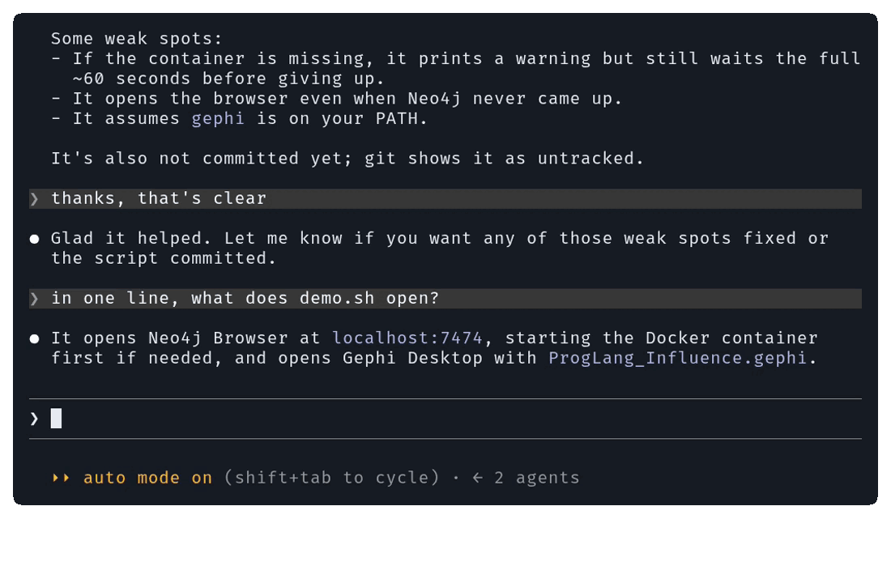

<div align="center">


</div>

**Keep Claude Code's prompt cache warm while you're away.**



[](https://github.com/404Mayank/cachebeat/actions/workflows/ci.yml)
[](https://code.claude.com/docs/en/plugins/mods/overview)
[](LICENSE)

When a Claude Code session sits idle, its prompt cache goes cold, and your next message has to rebuild it from scratch. That's slower, and it uses more of your usage limits. cachebeat gives the session a heartbeat: shortly before the cache would go cold, it sends a tiny background request that reads the conversation and keeps the cache alive. Your transcript never sees it.

You come back from lunch, type your next message, and it picks up right where you left off.

| Command | What it does |
| --- | --- |
| `/cachebeat on` | Keeps this session's cache warm, with no time limit |
| `/cachebeat 2h` | Keeps it warm for a set time, then turns off |

> [!IMPORTANT]
> **Changed in 0.10.0:** `/cachebeat on` works as before. `/cachebeat <time>` now sets how long to keep the cache warm, and needs a unit: `/cachebeat 2h` keeps it warm for two hours, then turns this session off. It used to set the beat interval in minutes (`/cachebeat 30`). A bare number now changes nothing and says so. The interval is a setting: **Beat after idle** in `/cachebeat settings`, or `/cachebeat global <minutes>`.

## Features

- **Background beats** keep the cache warm while you're idle or a turn sits waiting, timed to how long your cache lasts, and stay out of the conversation. `/cachebeat on` starts them
- **A keep-alive time**: `/cachebeat 2h` keeps the cache warm through a break of that long, then turns itself off
- **A cold guard** asks before your message goes to a cache that's gone cold, with how many tokens sending it would cache again. It's on from the start, even with beating off
- **A live heart** under the prompt, with 19 animations to choose from
- **A turn line** under your latest turn shows the beats so far and the time until the next one
- **A Status page and a Stats page**: the cache as it stands, and what beats cost and saved over the last 30 days
- **A settings menu** with live previews, driven by keyboard or mouse
- **Ask Claude** to turn it on, keep the cache warm for a while, or change any setting, in your own words, or ask it how full its context is and whether the cache is still warm
- **Safety stops** for long idle stretches, usage limits, errors, and chats too small to bother with
- **This session, this folder or all folders**: turn it on for one session, or have new sessions start with it in one folder or everywhere

## Requirements

- **Claude Code 2.1.332 or later.** Check your version with `claude --version` and update with `claude update`.
- **Claude Code in the terminal**, which cachebeat is built for. In the Claude desktop app, beating works the same: the turn line sits above the prompt, and the settings menu opens beside the chat. The wider heart animations and the menu's keyboard controls are rougher there, so you can just ask Claude to change settings for you. Nothing is drawn in `claude -p`.

## Install

In your terminal:

```sh
claude plugin marketplace add 404Mayank/cachebeat
claude plugin install cachebeat@cachebeat
```

Or from inside Claude Code:

```
/plugin marketplace add 404Mayank/cachebeat
/plugin install cachebeat@cachebeat
/reload-plugins
```

If `/cachebeat` isn't there afterwards, restart Claude Code.

**Update:**

```sh
claude plugin marketplace update cachebeat
claude plugin update cachebeat@cachebeat
```

Then restart Claude Code. To get new versions automatically, turn on auto-update under `/plugin` → **Marketplaces** → **cachebeat**.

**Uninstall:**

```sh
claude plugin uninstall cachebeat@cachebeat
claude plugin marketplace remove cachebeat
```

## Quick start

In any session:

```
/cachebeat on
```

The prompt heart appears under the prompt, and starts beating once the session has had a turn. To have every new session start with it on:

```
/cachebeat global on
```

Or only the sessions in this folder, such as one repo:

```
/cachebeat local on
```

To keep the cache warm for a set time, such as through a long meeting, and have it turn itself off after:

```
/cachebeat 2h
```

Or ask Claude: "keep the cache warm in this session", "keep it warm for the next 2 hours", "always start it in this repo", "make 30 minutes the default beat time".

To have Claude watch its own context, add a line to your `CLAUDE.md`, such as: "Before a long task, read your context with mcp__cachebeat__state (only: ["context"])."

Beats fit your cache by themselves: every 50 minutes on a Claude subscription's one-hour cache, and every 4 on the five-minute cache of an API key, a cloud provider or usage credits. To pick your own interval, use `/cachebeat global 30` or set **Beat after idle** in `/cachebeat settings`.

## What it sends, and what it costs

Each beat is one small request to the Anthropic API, made the way Claude Code makes its own requests: it carries the current conversation and asks for a one-character reply. The reply is thrown away, and nothing is added to your transcript. The request's last line is cachebeat's own: it starts with `[cachebeat]` and says it isn't from you, so a request log or a proxy can tell beats from your own messages.

- A beat counts toward your usage like any other request. Because it reads from the cache, it costs far less than rebuilding the cache would. Ask Claude, and it can tell you how much the last beat read and wrote, whether the cache is likely still warm, how big the conversation is, how full the context window is and when it will compact.
- Beats happen only while nothing else keeps the cache warm: while the session is idle, or while a turn sits waiting on a long tool run or a permission prompt. They come at most once per interval.
- cachebeat sends nothing anywhere else. It has no telemetry and makes no other network calls.
- To tell how long your cache lasts, cachebeat reads your `promptCacheTtl` setting, the variables `FORCE_PROMPT_CACHING_5M`, `CLAUDE_CODE_PROMPT_CACHE_TTL` and `ENABLE_PROMPT_CACHING_1H`, and whether your usage limits are reported, which they are on a subscription.
- `/cachebeat` and the two tools Claude uses, `mcp__cachebeat__state` and `mcp__cachebeat__set`, are answered by cachebeat itself. The tools read or change only cachebeat's own state and settings. Claude calls them without a permission prompt, and each call that goes through shows as one line in the transcript.
- With **Cold guard** on, cachebeat asks before sending your message to a session whose cache has gone cold, whether beating is on or not. After `/model` the new model has none of the conversation cached, so it asks then too, until a message or a beat on the new model caches it (turn **after /model** off to skip this). Messages nobody can be asked about (scheduled tasks, other sessions, `claude -p`, Slack and other channels) are sent as usual, and so are messages from Remote Control: before sending from your phone or the web to a session that may have gone cold, run `/cachebeat` there to see.
- cachebeat also sees `/model` switches, without changing them, so beats can wait for your next message or warm the new model, as **After /model** says.

## Privacy

- cachebeat collects no personal data and has no telemetry. It sends nothing to its author or anyone else.
- A beat is a request to Anthropic's API, made by Claude Code with your account, the same way your own messages are sent.
- Your settings stay on your machine, in cachebeat's own file in Claude Code's config folder, with the path of each folder you gave settings of its own. So does each conversation's on or off, keep-alive time, beat count, cold guard switch and when its cache was last read, by its session id, for 30 days from its last change, so that a resumed conversation picks up as you left it. With them, for each conversation, go its counts by day of beats and their tokens, turns kept warm, cold sends and the cold guard's questions, kept for the same 30 days to show on the Stats page. None of it is sent anywhere. What it reads to time beats (your cache settings, three environment variables, your usage limits) is read there and never sent anywhere.

## Commands

| Command | What it does |
| --- | --- |
| `/cachebeat` | Opens the [Status page](#what-youll-see), and answers with a line: on or off, the interval, the time left on a keep-alive time, beats so far, the next beat, and whether the cache is warm or cold. Typed while Claude is working, or from a remote session, it gives the line alone |
| `/cachebeat on` | Turns it on for this session, with no time limit |
| `/cachebeat off` | Turns it off for this session |
| `/cachebeat <time>` | Keeps the cache warm for that long from now, then turns this session off: `/cachebeat 2h`, `45m`, `1h30m` (5 minutes to 48 hours; the unit is required) |
| `/cachebeat now` | Beats right away |
| `/cachebeat guard on` / `off` | Turns the cold guard on or off for this session, whatever **Cold guard** says |
| `/cachebeat global on` / `off` | Sets whether new sessions start on, in all folders, and applies it here too |
| `/cachebeat global <minutes>` | Sets the interval for all folders, and turns it on here |
| `/cachebeat local on` / `off` / `<minutes>` | The same, for sessions in this folder only |
| `/cachebeat local reset` | Drops this folder's own settings: it follows all folders again |
| `/cachebeat stats` | Opens the Stats page, and answers with a line of the last 30 days. Typed while Claude is working, or from a remote session, it gives the line alone |
| `/cachebeat settings` | Opens the settings menu, on its Beating tab |

A command typed while Claude is working takes effect at once. Claude Code shows the command and its reply in the transcript only when the turn ends, so cachebeat shows the reply in a toast right away.

## What you'll see

**The prompt heart** sits at the end of the hint line under the prompt, with the beat count beside it. It beats while a beat is scheduled, bursts when one lands, and holds still while it waits for your next message or while a request of your turn is on its way. It shows during a turn too.

**The turn line** sits under your latest turn. Before the first beat it reads `♡ next beat in 50m`, and after that `♥ cache kept warm ×3 · 184k cached · next in 42m`, with the time left (`· 1h 52m left`) while a keep-alive time is set. Its heart beats too, with an animation of its own under **Turn line**. When beats wait for your next message (see [Good to know](#good-to-know)), it says so; a cache that went cold reads `♡ cache went cold · beats start again on your next message`. When you send a new message, the line moves to that turn once it ends. Until then, in the terminal, a beat during the turn shows as a line in the log. In the desktop app the line stays above the prompt instead.

```
✻ Cogitated for 12s · done 3:09 PM

♥ cache kept warm ×3 · 184k cached · next in 42m

❯
  ⏸ manual mode on · ⠀(♥)⠀ ×3
```

**The Status page** is the first tab of the menu, and `/cachebeat` opens it. It is read-only, and it shows this session as it stands: whether the cache is warm or cold, with its lifetime, when it was last read and how long it has left, or how long it has been cold, or that the model changed since; the conversation's size in tokens; whether this session beats, at what interval, and when the next beat is due; the beats so far and what the last one read and wrote; the cold guard; your usage limits and where beats stop; and when you last sent a message. It updates each minute while it is open. Warm or cold is judged by the time since the cache was last read, and the model it was read on; only the next request confirms it.

**The Stats page** is the second tab, and `/cachebeat stats` opens it. It adds up what beats cost and what they saved, for today, the last 7 and 30 days, and this session, across every session on your machine:

- **Beats · cost:** the beats sent, and the tokens they read and wrote.
- **Kept warm · avoided:** the turns that came back to a cache only beats had kept warm, and the tokens they didn't have to cache again. A turn that came back before the cache would have lapsed anyway isn't counted.
- **Net:** the avoided tokens less the cost, which can be negative: a beat costs something even when no message follows.
- **Cold sends · re-cached:** the messages sent on a cold cache, and the tokens they cached again.
- **Guard asked:** the messages the cold guard asked about.

Cost, avoided and net are in input tokens: each request counts by its model's cache prices, a read for a small part of an input token and a write for more than one (an hour's cache twice as much, five minutes' a quarter more). A model cachebeat has no prices for is counted at the usual ones, and the page says so. Under them, one block a day shows the beats of the last 30. It is all counted by cachebeat itself, so it begins when you update to this version.

## Settings

Open the menu with `/cachebeat settings`, or ask Claude to change a setting. Settings apply in all folders, unless you give a folder its own (see [Where settings apply](#where-settings-apply)).

- On the tab bar, ↑↓ switch tabs and Enter goes into one. 1–7 jump straight into a tab, Status and Stats first.
- Inside a tab, ↑↓ move between settings. Enter flips a setting with two choices, or opens the list of one with more. A dim line at the bottom says what the focused setting does.
- **r** puts the focused setting back to its default. On a folder's own setting, it goes back to the one for all folders. On **This session** with a keep-alive time, it drops the time, and the session keeps beating with no limit.
- In a list, ↑↓ preview each choice and Enter picks it.
- Esc goes back one step, and closes the menu from the tab bar.
- The mouse works too: click to pick, scroll to scroll.

Settings with numbers also take a custom value at the bottom of their list, such as `35` minutes, `90m`, or `35k` tokens. A value out of range is refused, with what the setting takes. Your last custom value stays in the list after you pick another, so it's one Enter from coming back.

### Where settings apply

| | What it holds | How long it lasts | How to set it |
| --- | --- | --- | --- |
| **This session** | Whether it beats, and for how long (a keep-alive time) | Until the session ends, and again when you resume the conversation; `/clear` keeps it, `/resume` takes the resumed conversation's | **This session** on Beating, `/cachebeat on`, `off` or `<time>` |
| **This folder** | Any setting, for sessions in this folder | Until you change it | **Settings for: this folder** in the menu, or `/cachebeat local …` |
| **All folders** | Every setting | Until you change it | The menu, or `/cachebeat global …` |

The nearest one wins: this session's switch over **New sessions start**, and a folder's own setting over those for all folders. A keep-alive time belongs to the session alone, and no interval you save changes it.

**Settings for** picks where the menu saves your changes. It never changes **This session**. On `this folder`, changes are saved for this folder alone and marked `· this folder`; the rest still follow all folders, so a later change to all folders reaches this folder too. On `all folders`, a setting this folder sets for itself is marked `· here: on`, with this folder's value. The menu opens on `this folder` once the folder has settings of its own, and on `all folders` otherwise. **Reset folder** (or `/cachebeat local reset`) drops the folder's own settings.

A folder is where the session started, or where `/cd` or a worktree move took it. Each folder is its own, so a subfolder or another worktree doesn't share its settings.

<details>
<summary><b>Beating</b>: whether it's on, and how often</summary>

| Setting | What it does | Default |
| --- | --- | --- |
| This session | Turns beating on or off right here, and when a keep-alive time ends | off |
| New sessions start | Whether new sessions start with it on | off |
| Beat after idle | How long the session sits idle before a beat: auto fits your cache, or a number of minutes | auto: 50 minutes on a one-hour cache, 4 on a five-minute one |
| After /model | Wait for your next message, or have the next beat warm the new model's cache | wait |

**Beat now** sends a beat right away, and **Reset all** puts every setting back to its default. With **Settings for** on `this folder`, it's **Reset folder**, which drops the folder's own settings.

</details>

<details>
<summary><b>Limits</b>: when beating stops or skips, and the cold guard</summary>

| Setting | What it does | Default |
| --- | --- | --- |
| Stop after idle | Stops beating after this long without a message from you. A session with a keep-alive time (`/cachebeat 2h`) keeps to that instead | 8 hours |
| Cache gone cold | If the cache goes cold before a beat reaches it (say, your computer slept): start beating again on your next message, or stop. On auto, a beat that finds the cache lasts five minutes: beat every 4 minutes from there, or stop | start on your next message |
| Cold guard | Asks before sending a message to a session whose cache has gone cold, saying how long it's been cold, or that the model changed, and how many tokens sending it caches again. It asks about chats from a minimum size. A question left unanswered doesn't send the message and closes after 5 minutes, or sends it after a few minutes if you choose. While it's open, other incoming messages (from other sessions, say) wait for it. **after /model** has it ask too while the new model has no cache of the chat yet | on, from 20k tokens, don't send (closes after 5m), after /model on |
| Stop at usage | Stops once any of your usage limits reaches this percentage | 90% |
| Skip small chats | Skips beating chats under a minimum size | off, 20k tokens |

With **Skip small chats** on, cachebeat tells you up front when a chat is under your minimum, once in the log and in the turn line: `♡ beats skip · this chat is 38k tokens, under your 50k minimum`. It starts beating as soon as the chat grows past the minimum.

</details>

<details>
<summary><b>Heart</b>: the heart under the prompt</summary>

| Setting | What it does | Default |
| --- | --- | --- |
| Placement | At the end of the hint line, drawn dim, or on its own line, in color | hint line |
| Animation | Which of the 19 animations the heart plays | Classic |
| Beat count | Shows the `×3` beside the heart | on |
| Color | On its own line: dim, a color from your theme, a preset, or any hex color | claude, your theme's accent |
| Animate | Turns its animation on or off | on |
| Effect | On its own line: steady; flash on each beat; flow, a shimmer sweeping across; or mixed, which switches between them | steady |
| Speed | Slow, normal, fast, or a custom frame time | normal |
| Timing | Lub-dub beats twice, then rests, and suits the hearts; linear plays evenly, and suits the line animations | lub-dub |

The Animation list plays every animation at once, so you can watch them side by side before you pick: Classic, Pulse, Triplet, Sparkle, Fleuron, Wave, ECG, Beam, Dash, Sine, Charge, Converge, Twins, Orbit, Static, Garland, Equalizer, Cupid and Bounce.

```
Classic    ⋅ ♡ ⋅            ECG     ─⎼⎺⎽────⎼⎺⎽───♥
Sparkle    ✦ ♥ ✦            Sine    ⠒⠉⠒⠤⣀⠤⠒⠉⠒⠤⣀⠤⠒⠉❤︎
Orbit       •♥              Cupid       ─➤ ♡
```

The desktop app draws no heart under the prompt.

</details>

<details>
<summary><b>Turn line</b>: the line under your latest turn</summary>

| Setting | What it does | Default |
| --- | --- | --- |
| Show | Under the turn after a blank line, directly under it, or off | after a blank line |
| Countdown | Shows the time to the next beat | on |
| Tokens kept | Shows how much the last beat kept warm, e.g. `· 184k cached` | on |
| Its heart | What the heart at the start of the line plays: one heart beating, a still one, or any of the 19 animations | one heart, beating |
| Color | Dim, a color from your theme, a preset, or any hex color | claude, your theme's accent |
| Animate · Effect · Speed · Timing | As for the prompt heart, for the line on its own | on · steady · normal · lub-dub |

Theme colors follow your Claude Code theme, so they change when you switch themes. In the desktop app the line sits above the prompt.

</details>

<details>
<summary><b>Alerts</b>: how beats, stops and other notices are announced</summary>

| Setting | What it does | Default |
| --- | --- | --- |
| On a beat | Log, toast, both, or nothing when a beat lands | nothing |
| On stop | Log, toast, both, or nothing when beating stops by itself | log |
| Notices | Log, toast, both, or nothing for the other lines: beats waiting for your next message, resuming, skipping or going on, a new model's cache, beats every 4 minutes on a five-minute cache, a message sent on a cold cache | log |

</details>

## When it stops on its own

cachebeat turns itself off for the session when:

- you haven't sent a message for longer than **Stop after idle** (a session with a keep-alive time doesn't stop for this)
- its keep-alive time is up: it kept the cache warm as long as you asked
- a usage limit reaches **Stop at usage**
- the API rate-limits it, or returns an error that doesn't clear up (a passing hiccup is retried a minute later)
- there's no conversation yet to keep warm

If the cache goes cold before a beat reaches it, as when your computer sleeps, cachebeat waits and starts beating again on your next message. Set **Cache gone cold** to stop to have it turn off instead.

It tells you why, the way you chose under **Alerts**. On auto, a cache that's gone before a 50-minute beat lasts five minutes: instead of stopping, cachebeat says so and beats every 4 minutes from there, unless **Cache gone cold** is set to stop.

## Good to know

- Don't run another keep-warm plugin beside cachebeat. Two sets of beats and two cold guards in one session behave unpredictably.
- A keep-alive time counts from the command, and your messages don't extend it. Beats come only while the cache would otherwise go cold before the time is up, so the last one can come well before the end. A running turn finishes first, then the session turns off. A usage limit or an API error still stops it early.
- Sending a message restarts the countdown, and so does each request Claude makes during a turn. A turn gets a beat once it has gone quiet for a whole interval, counted from its last request. A conversation's first turn gets none.
- The countdown runs from when a request was sent, not from when its answer ended, since that's when the cache's lifetime starts. So a long answer brings the next beat sooner, and one that streams for longer than the cache lasts leaves it cold.
- After `/compact`, after `/rewind`, and after `/model` unless **After /model** is set to warm the new model, beats wait for your next message: there's no cache for it yet.
- A resumed conversation (`claude --resume`, `--continue`, or `/resume`) picks up as you left it: on or off, and any time you gave it, unless that time ran out while it was closed, which leaves it off. What it was is kept for 30 days from its last change; without it, the conversation starts as **New sessions start** says, as one started with `--fork-session` does. Coming back off from a session that was on, it says so. Beats start after your next message, since nothing of it is cached in this session yet, and a line says whether the cache is likely still warm.
- After a conversation's first turn, Claude Code can cache the conversation anew where a beat can't reach it. A beat that finds this says so once, and beats wait for your next message rather than paying to write the cache again each time.
- If the cache goes cold before a beat reaches it, as when your computer sleeps, beats wait for your next message too, and say so (unless **Cache gone cold** is set to stop).
- `/clear` starts a fresh conversation: the count goes back to zero, and beats resume after your first message.
- `/cachebeat now` needs at least one turn in the session, since before that there's nothing cached to keep warm.
- Settings you change in one session reach your other open sessions at their next turn. A session moved to another folder takes that folder's settings at its next turn, and stays on or off as it was.

## Contributing

Contributions are welcome. Read [the contributing guide](https://github.com/404Mayank/cachebeat/blob/dev/notes/contributing.md) to get started.

## License

[MIT](LICENSE)

## Disclaimer

cachebeat began as a personal project and is shared publicly in good faith. It's actively maintained: report problems or ideas as a GitHub issue and they'll be looked at, though what gets fixed or added is up to the maintainer.

Every beat is a real request that counts toward your usage limits, or toward your API bill if you pay per token. You use cachebeat at your own risk, and its author isn't responsible for any usage, charges or other costs it causes.
